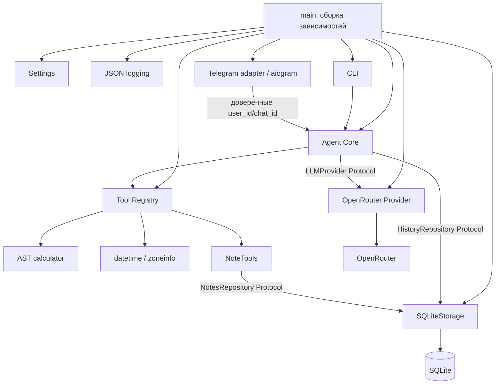

# Архитектура Профилабыча

## Состояние третьего этапа

Сохранён один Python-пакет с src layout и прежними границами. Реализованы ядро,
LLM Provider, Registry, SQLite, CLI и Telegram. Нет DI-контейнера или агентного framework.
`main.py` собирает зависимости аргументами и владеет жизненным циклом ресурсов.
Telegram использует установленный aiogram 3. Импорты не читают настройки,
не открывают SQLite и не делают сетевых запросов.

| Компонент | Ответственность |
| --- | --- |
| `agent/core.py` | История, последовательный цикл, лимиты, обработка LLM-ошибок, сериализация пользователя |
| `llm/models.py` | Неизменяемые Pydantic Message/ToolCall, async Protocol LLMProvider, безопасный LLMError |
| `llm/openrouter.py` | HTTP Chat Completions, preflight тарифа/tools, timeout/retry, нормализация |
| `llm/fake.py` | Скриптовые ответы и запись запросов для тестов и явного offline demo |
| `tools/registry.py` | Регистрация, схема из модели параметров, строгая валидация, поиск, timeout, результат, логи |
| `tools/calculator.py`, `current_time.py`, `notes.py` | Конкретные функции инструментов |
| `storage/contracts.py` | Protocol истории/заметок, Note, StorageError, проверка идентификаторов |
| `storage/history.py` | Проверка завершённого хода и обрезка по границам ходов |
| `storage/sqlite.py` | Одна управляемая aiosqlite connection, схема и атомарные транзакции |
| `interfaces/cli.py` | Ввод, ответы, /reset, /exit; бизнес-логики нет |
| `interfaces/telegram/handlers.py` | /start, /help, /reset, проверка текста, передача доверенных ID одному Agent |
| `interfaces/telegram/presentation.py` | Обычный текст, UTF-16 разбиение, доставка и typing |
| `interfaces/telegram/middleware.py` | Личные сообщения людей, дедупликация update_id и завершение обработчиков |
| `interfaces/telegram/polling.py` | Dispatcher, message polling, остановка polling/обработчиков |
| `config.py`, `logging.py` | Неизменяемые Settings, ограниченные JSON-логи, секреты и request context |

## Контракт и цикл ядра

Вход: `await agent.handle(user_id, text, chat_id=0) -> str`. user_id обязан быть
положительным int из доверенного приложения; Telegram берёт его из from_user.id,
chat_id из chat.id. CLI использует локальные идентификаторы без аутентификации.

1. Agent получает блокировку user_id, создаёт уникальный request_id и загружает
   историю данного чата.
2. В оперативный буфер хода добавляется user message; к context добавляется
   фиксированный system prompt. Ранее завершённые ходы обрезаются целиком.
3. Provider получает Message sequence, схемы registry и tool_choice=auto.
4. Assistant text завершает ход. Если есть tool_calls, проверяются бюджет,
   уникальность ID и лимиты до выполнения.
5. Каждый вызов исполняется последовательно через Registry с доверенным
   ToolContext(user_id, chat_id, request_id). Ошибки аргументов/инструментов
   становятся ToolResult(ok=false, error={code,message}).
6. Assistant с полным списком calls сохраняется в буфере перед role=tool
   сообщениями с исходными ID, в исходном порядке.
7. Provider снова получает весь текущий ход и достаточно предыдущих завершённых
   ходов. Схемы отправляются на каждом completion.
8. Максимум 5 раундов tools; отдельный лимит фактических вызовов по умолчанию 5,
   configurable до 20. После исчерпания есть один запрос итогового текста с none;
   дополнительные calls отвергаются. Не более 6 completion-вызовов за ход.
9. Полный завершённый ход атомарно добавляется в SQLite, затем возвращается ответ.

Ядро не импортирует aiogram, httpx или реализацию SQLite. Protocol провайдера и
репозиториев позволяет подменять инфраструктуру в тестах. Модель задаётся только
Settings и адаптером, ядро не содержит условий для Qwen/DeepSeek.

Блокировка живёт только пока есть активные/ожидающие запросы пользователя,
включая reset. Разные пользователи не блокируют друг друга на ожидании LLM.
Это гарантия одного экземпляра Agent в одном процессе, а не распределённая очередь.
Telegram использует один Agent на приложение.

## Telegram и жизненный цикл

`--telegram` добавлен к mutually exclusive режимам `--check` и `--demo`; запуск
без флага остаётся CLI. Settings уже содержит TELEGRAM_BOT_TOKEN, OPENROUTER_API_KEY
и LLM_MODEL, поэтому новые параметры/зависимости не потребовались. Отсутствующие
ключи и неверный формат Telegram-токена отклоняются до сети и SQLite.

Composition root открывает httpx/Provider, проверяет модель, открывает SQLite,
строит Agent и Bot. Только затем начинается polling. При отказе preflight ресурсы
закрываются и Telegram не стартует; оператор получает безопасную причину отказа.
`user_id` и `chat_id` передаются из события, CLI-флаги на Telegram не влияют.
Адаптер не содержит схем инструментов, промптов, цикла LLM или SQL.

UpdateGuard пропускает только `Update.message` в private chat с положительным
from_user.id и is_bot=false. Фильтр применяется перед командами и обычным текстом.
Caption/media не становятся LLM-вводом; edited_message и channel_post игнорируются.
Текст проверяется по USER_INPUT_MAX_CHARS до Agent. Команды start/help локальные,
reset вызывает Agent.reset_history(user_id, chat_id=chat.id), остальные команды
получают подсказку. Текстовый запрос вызывает Agent.handle с теми же ID.

ID резервируется до первого await. Активные ID хранятся отдельно от FIFO-кеша
последних 10000 завершённых ID, поэтому вытеснение кеша не удаляет защиту активного
запроса. Ошибка доставки, ошибка обработки и отмена оставляют ID завершённым:
инструмент мог уже зафиксировать побочный эффект. Кеш непостоянный; после
перезапуска/вытеснения возможна повторная обработка. Гарантий exactly-once нет.

Ответ отправляется частями в исходном порядке; каждый фрагмент не больше 4096
UTF-16 units. Границы строк/слов предпочтительнее жёсткого разрыва, whitespace-only
части пропускаются. formatting.py преобразует только парные **bold** и inline code
в собственные entities, считая UTF-16 offsets. После разбиения entities пересекаются
с границами фрагмента; смещения учитывают пропущенный whitespace-only текст.
HTML, ссылки, fenced code и неподдерживаемая разметка остаются буквальным текстом.
parse_mode=None, link preview отключён,
allow_paid_broadcast=false. Telegram API errors/ClientDecodeError логируются
типом и chat_id, без описания и тела. Только явно отклонённый запрос с RetryAfter
до 5 секунд повторяется один раз; неоднозначные сетевые ошибки не повторяются.
Typing отправляется сразу, затем каждые 4 секунды отдельной задачей; ошибка typing
не отменяет запрос. Задача отменяется и ожидается при любом выходе.

В Dispatcher отключён FSM, подписка только на message, до 16 активных обработчиков.
UpdateGuard отслеживает обработчики и на shutdown закрывает вход, отменяет задачи
и дожидается их. Одна задача пользователя не блокирует другие user_id внутри Agent.
Ошибки программирования изолируются error handler aiogram, фиксируется тип ошибки
и update_id; пользователю возвращается нейтральный ответ, отмена не подавляется.

aiogram не ожидает всех update handlers автоматически. Его start_polling запускается
под asyncio.shield: при внешней отмене wrapper ждёт готовности startup и вызывает
stop_polling, чтобы завершить внутренний getUpdates worker. Shutdown hook и finally
UpdateGuard дожидаются обработчиков до возврата из run_polling. Затем контекст Bot
закрывает Telegram session, контекст SQLite — БД, Provider/httpx — HTTP-клиент.
Startup failures проходят тот же finally. Жёсткое завершение процесса и повторная
принудительная отмена во время shutdown не являются graceful shutdown.

Настройки внешних аккаунтов, webhook и меню команд не изменяются приложением.
Polling предполагает один процесс и отсутствие установленного webhook. Live-запросы
требуют отдельного разрешения Product Owner; офлайн-тесты используют настоящие
Dispatcher/Update с подменённой BaseSession, Fake LLM и httpx.MockTransport.

## OpenRouter

Перед первым запросом проверяется каталог `/models`. Fail closed при неизвестной
модели, неизвестной/ненулевой стоимости или отсутствии tools/tool_choice.
Кеш действует на срок жизни адаптера; каждый completion независимо отправляет
нулевой provider.max_price и require_parameters=true. allow_fallbacks=false,
models fallback, плагины OpenRouter и платные идентификаторы не используются.

HTTP-клиент асинхронный и передаётся явно. Адаптер закрывает его через aclose/context
manager. Composition root дополнительно владеет внешним AsyncClient context,
так что ошибка конструктора/preflight тоже закрывает клиент. Redirect запрещён,
trust_env=False исключает неожиданное проксирование ключа окружением процесса.

Каждая HTTP-попытка ограничена общим asyncio timeout и httpx timeout. Retry только
для transport/timeout, 429, 500/502/503/504, до 3 дополнительных попыток. Backoff
и Retry-After ограничены 5 секундами. Отмена не перехватывается как ошибка retry.
GET каталога ограничен 8 МБ, completion — 1 МБ. JSON/schema, роль, finish_reason,
ID и наличие текста/calls проверяются; length/content_filter/error не принимаются
как успешное завершение. Дополнительные поля reasoning провайдера не входят в
нормализованные сообщения и не сохраняются. Сырые ошибки не попадают в публичный
LLMError. Потоковая генерация и мультимодальные messages сейчас не поддерживаются.

Контракт соответствует [официальному описанию API](https://openrouter.ai/docs/api/reference/overview),
[tools](https://openrouter.ai/docs/guides/features/tool-calling) и
[provider selection](https://openrouter.ai/docs/guides/routing/provider-selection).
На этом этапе HTTP проверялся только MockTransport, реальная доступность модели
не проверялась. `:free` сам по себе не означает доступный endpoint.

## Registry и инструменты

Tool содержит имя, описание, тип Pydantic параметров и async-handler. Одна модель
является источником JSON Schema и runtime-проверки. Встроенные модели strict и
extra=forbid: числа не подменяются строками, дополнительные user_id отвергаются.
Registry обеспечивает уникальные имена, find/schemas/execute, timeout и размер
ToolResult. Handler получает проверенные параметры и отдельный ToolContext.

Для нового инструмента определяются модель параметров и функция, затем Tool
регистрируется в main.build_agent. Изменения Agent Core не нужны. Ожидаемые ошибки
handler должен выражать ToolError; ошибки программирования не скрываются broad
except. ToolResult передаётся LLM как JSON, сохраняя tool_call_id.

Calculator разбирает expression AST и исполняет только белый список узлов/операций
через Decimal. Длина/число узлов/вложенность/числа ограничены. current_time применяет
стандартные datetime/ZoneInfo. NoteTools зависит от NotesRepository, получает
owner из ToolContext, schema никогда не принимает идентификатор пользователя.
list_notes поддерживает ограниченные страницы, сохраняя порядок created_at/id.
Settings.default_timezone проверяется через ZoneInfo и по умолчанию Europe/Moscow.
Composition root передаёт её current_time через partial и NoteTools через конструктор.
timezone в current_time опционален: отсутствие/null означает настройку приложения,
явный IANA timezone имеет приоритет. Время отдаётся как ЧЧ:ММ и готовая фраза answer.
NoteTools преобразует UTC created_at в ДД.ММ.ГГГГ ЧЧ:ММ только для результата инструмента.
Agent Core получает уточнённые инструкции о времени и датах; цикл tools не меняется.

## Хранение, целостность и ошибки

SQLiteStorage автоматически создаёт schema/indexes и родительский каталог. WAL
и busy_timeout включены, I/O — aiosqlite. Все SQL с пользовательскими значениями
параметризованы. Одно asyncio.Lock сериализует транзакции connection; BEGIN IMMEDIATE,
commit/rollback применяются также при отмене. История хранится в history_turns
с user_id/chat_id и JSON завершённого хода, заметки в notes с owner и UTC created_at.

Перед записью проверяются начало user, конец assistant text, полный упорядоченный
набор tool results и уникальность call IDs в ходе. Старые ходы удаляются целиком
в той же транзакции. HISTORY_MAX_MESSAGES/CHARS ограничивают также контекст; system
prompt добавлен сверх лимита. Текущий ход сохраняется целиком: перед вызовами
резервируется максимальный размер tool results и место для локального финала.
При недостатке места выполнение останавливается до побочных эффектов новой группы.

reset_history(user_id) удаляет историю всех чатов пользователя; переданный chat_id
сужает reset до одного чата. Таблица notes не изменяется. Для будущих операций
с конкретной заметкой обязательна проверка owner, а не только ID.

Ожидаемая ошибка инструмента отправляется модели и позволяет повторить вызов с
исправленными аргументами. LLMError, лимит или неверная роль/повтор ID завершают ход
локальным понятным ответом; для любого LLMError ответ строго «Сервис временно
недоступен. Попробуйте позже.». Код ошибки остаётся в логах, детали не входят
в историю или пользовательский ответ. Уже завершённые группы остаются в истории. Отклонённый
ответ с необслуженными calls в историю не добавляется. Ошибка записи БД выражается
AgentError, ответ не выдаётся как успешно сохранённый. При отмене до финального
сохранения незавершённые ID закрываются результатом interrupted, записывается
локальный финал и CancelledError распространяется. Отмена самого финального commit
не вызывает повторную запись: commit мог уже завершиться. Если БД также недоступна,
фиксируется только безопасный лог.

Ход диалога и отдельные инструменты не охвачены общей транзакцией. save_note может
закоммититься до ошибки LLM, истории или timeout/cancellation. Дедупликация Telegram
update действует только в пределах кеша текущего процесса; идемпотентность нового
запроса и crash recovery отсутствуют. Нельзя обещать exactly-once
или сохранение текущего буфера при аварийном завершении процесса.

## Логирование и развитие

Существующий JSON formatter расширен лимитами строк/коллекций/глубины/обхода;
маскирование выполняется до усечения. Секреты передаются на старте, шаблоны tokens,
Bearer и чувствительные ключи маскируются. Request ContextVar переносит user_id,
chat_id/request_id во вложенные provider logs без утечек между asyncio tasks.
Тексты/аргументы/результаты логируются ограниченно согласно новому требованию этапа 2;
сырые HTTP-тела/настройки не логируются, HTTP/aiosqlite/aiohttp debug подавлен.
JsonFormatter заменяет сообщения aiogram на telegram_framework_event без args,
context и traceback: framework способен включить сырое описание Telegram в ошибку.
Собственные события адаптера содержат безопасные типы ошибок и ID.

Следующий шаг: отдельно разрешённый smoke test Telegram и бесплатного OpenRouter.
Далее Product Owner определяет требования следующего этапа. RAG, PDF, голос,
дополнительная память, ReAct и мультиагентность остаются отдельными расширениями.
